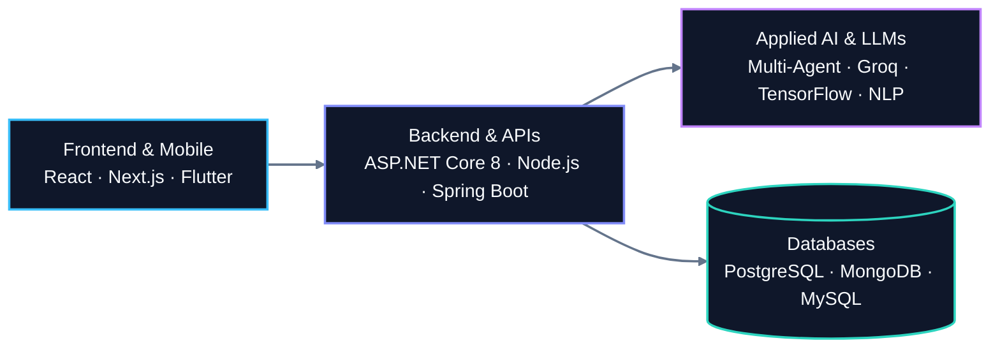

# Parami Ramanayake

 

&nbsp;
&nbsp;

---

### About Me

AI & Machine Learning undergraduate and Full-Stack Software Developer focused on bridging complex algorithmic logic with scalable, production-ready applications.

- **Full-Stack Engineering:** Building end-to-end web & mobile platforms with clean API architecture and role-based security.
- **Applied AI & LLMs:** Designing multi-agent orchestration pipelines, automated validation, NLP, and predictive ML models.
- **Data & Backend Systems:** Architecting relational and NoSQL databases across PostgreSQL, MongoDB, and MySQL.

---

### Tech Stack

**Frontend & Mobile**  

**Backend & Databases**  

**Languages & Developer Tools**  

**AI / ML & Ecosystem Tools**  

---

### Engineering Highlights *(Click to expand)*

  
<b>1. AI-Powered Intelligent Exam Preparation Platform</b> — <i>ASP.NET Core 8 · React · Flutter · PostgreSQL · Groq LLM</i>

   

  - Architected an end-to-end cross-platform ecosystem uniting a **React** admin dashboard, **Flutter** student mobile app, and **ASP.NET Core 8
